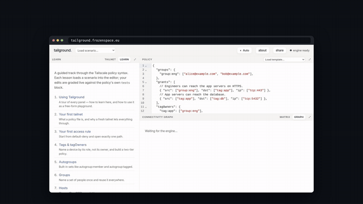

# democast

Record scripted demo videos of your products, browser, terminals without worrying about the demo Gods.

Write a YAML scene: title cards, captions, clicks and typing in the browser,
commands in the terminal. democast plays it in headless Chrome, runs the
commands for real, and encodes MP4s for social media (16x9, 1x1, 4x5, 9x16;
1080p or 4K). Nothing is mocked, and values can flow between the page and
the terminal.



```
npm install
node src/cli.js examples/tailground.yaml        # record every format in the scene
node src/cli.js -f 9x16 -o out scene.yaml       # one format
node src/cli.js check scene.yaml                # validate without running
node src/cli.js edit scene.yaml                 # timeline editor
node src/cli.js render scene.yaml               # re-render takes with edits
```

Output: `out/<scene>-<format>.mp4`, a contact sheet PNG, and `.srt` if the
scene has narration. `npm link` installs `democast` globally. `make help`
lists the make wrappers.

Tested on Linux and macOS, Node 20+, ffmpeg, and Chrome/Chromium/Edge.

Can record for YouTube, LinkedIn, X or vertical for Instagram Reels, TikTok, Shorts.

A minimal scene:

```yaml
site: https://example.com/
formats: [16x9]
steps:
  - caption: Hello
  - browser.click: "a"
  - term.run: echo done
  - say: "That's it."
```

## Docs

- [docs/reference.md](docs/reference.md): flags, steps, formats, login, narration, remix, sources, editor, CI
- [examples.md](examples.md): every feature with a scene and screenshot
- [schema/scene.schema.json](schema/scene.schema.json): editor completion and validation

