# democast examples

Every way to use democast, each with a scene you can copy. The scenes here
are complete files, and each one passes `democast check`. For the full
reference (every setting and flag), see the [reference](docs/reference.md); the
runnable example in [examples/](examples/) is `tailground.yaml` (a browser-only scene).

**Try them.** The examples with a screenshot run against a small demo
site in [docs/site/](docs/site/), served on `http://127.0.0.1:7799/`, so
they behave the same everywhere and need no account. Start it in one
terminal and record any example from [docs/scenes/](docs/scenes/) in another:

```
make docs-site                                    # serve the demo site (Ctrl-C to stop)
node src/cli.js docs/scenes/forms.yaml            # record one example
make doc-images                                   # redo every screenshot here (SCENES="forms popup" for some)
```

Each scene shown below is the file in `docs/scenes/`, word for word (a test
checks it), and each screenshot is a frame from recording it.

1. [The basics](#1-the-basics)
2. [Browser-only scenes](#2-browser-only-scenes)
3. [Terminal-only scenes](#3-terminal-only-scenes)
4. [Browser and terminal together](#4-browser-and-terminal-together)
5. [Two terminals](#5-two-terminals)
6. [Stage: cards, captions, views](#6-stage-cards-captions-views)
7. [Narration](#7-narration)
8. [Formats, resolution and frame rate](#8-formats-resolution-and-frame-rate)
9. [Sites behind a login](#9-sites-behind-a-login)
10. [Setup and teardown](#10-setup-and-teardown)
11. [Privacy: redact and blur](#11-privacy-redact-and-blur)
12. [Popups and OAuth](#12-popups-and-oauth)
13. [Variables and environment](#13-variables-and-environment)
14. [Music](#14-music)
15. [Smooth takes and sources](#15-smooth-takes-and-sources)
16. [The timeline editor](#16-the-timeline-editor)
17. [Remix: new videos from recorded takes](#17-remix-new-videos-from-recorded-takes)
18. [Checking a scene](#18-checking-a-scene)
19. [Flaky networks: retries and waiting](#19-flaky-networks-retries-and-waiting)
20. [Make targets](#20-make-targets)
21. [Running in CI](#21-running-in-ci)

---

## 1. The basics

The smallest useful scene: a site, a caption, a click.

<!-- scene: basics -->
```yaml
site: http://127.0.0.1:7799/
steps:
  - caption: { text: Acme Notes, sub: "A demo site for democast's examples" }
  - wait: 1500
  - browser.click: "#get-started"
  - wait: 1500
```

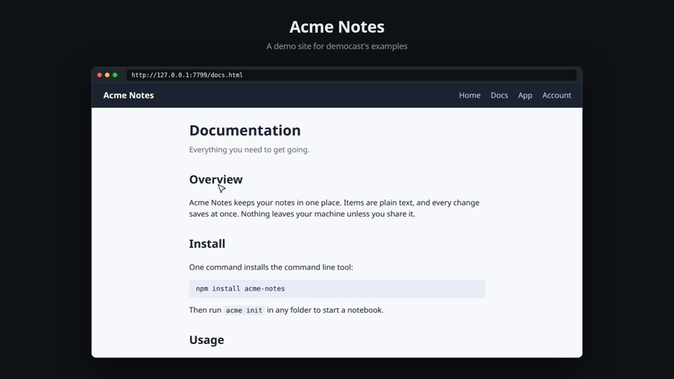

Record it, then look at `out/`:

```
node src/cli.js scene.yaml
```

| Output | What |
|---|---|
| `out/scene-16x9.mp4` | the video |
| `out/scene-16x9-sheet.png` | a contact sheet of 12 frames, to check a take without watching it |
| `out/scene-16x9.srt` | subtitles, if the scene has narration |
| `out/scene-16x9.raw.mkv`, `.take.json`, `.narration/` | the kept take, so the editor and `democast render` work without recording again |
| `out/scene-16x9-error.png` | only when a step fails: a screenshot of that moment |

The first line is optional. With the YAML extension in your editor it gives
completion and checks as you type; the path is relative to the scene file.

Every scene setting, in one place (all optional):

```yaml
name: full-settings            # output file prefix (default: the file name)
site: https://example.com/     # loaded into the browser panel at the start
siteLabel: example.com         # what the fake URL bar shows (default: site)
formats: [16x9, 9x16]          # default: 16x9
fps: 30                        # frame rate (default 30)
timeout: 60000                 # default per-step timeout, ms
autoFocus: true                # 9x16: switch to the panel each step uses
layout: focus                  # 9x16: focus (default), both (stacked) or max (fills the frame for one-panel scenes)
env: { GREETING: hello }       # extra environment for terminal commands
browser:
  scale: 1.2                   # zoom of the site; or { 16x9: 1.2, 1x1: 1.0 }
terminal:
  title: "~ — bash"
  fontSize: 21                 # or per format
  cps: 28                      # typing speed, characters per second
theme:                         # override any stage CSS color
  bg: "#0e1116"
  accent: "#7ee787"
voice: { engine: kokoro, voice: am_michael }
steps:
  - caption: Every setting
```

---

## 2. Browser-only scenes

A scene with a `site` (or any `browser.*` step) and no `term.*` steps gives
the browser the whole stage.

### Forms: type, fill, press

<!-- scene: forms -->
```yaml
site: http://127.0.0.1:7799/login.html
siteLabel: acme.test/login
steps:
  - caption: Sign in
  # type: real key events, one at a time; seed makes the pauses the same every take
  - browser.type: { selector: "#email", text: "demo@acme.test", cps: 20, seed: 42 }
  # fill: replaces the contents at once, like a paste
  - browser.fill: { selector: "#password", text: "not-a-real-password" }
  - browser.click: "button[type=submit]"
  - browser.waitFor: { text: "Welcome back" }
  - wait: 1000
```

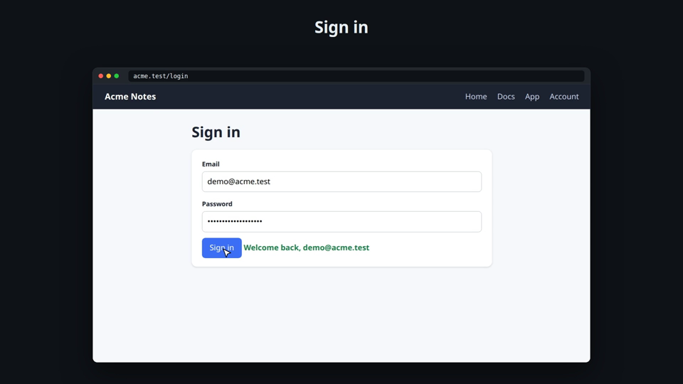

More ways to enter text:

```yaml
steps:
  - browser.press: Tab
  - browser.press: { key: ArrowDown, times: 3 }
  - browser.press: Control+a
  - browser.type: { selector: "#email", text: "other@example.com", clear: true }   # replace what is there
  - browser.type: { text: "typed with focus\n" }                                   # no selector: types where the focus is; \n is Enter
```

`seed` makes the pauses between keys the same on every take.

### Waiting for the page

Steps wait for conditions, not fixed delays, so a slow network makes a longer
video, not a broken one.

<!-- scene: waiting -->
```yaml
site: http://127.0.0.1:7799/app.html
steps:
  - caption: Waiting for the page, not for a timer
  - browser.waitFor: { selector: "#results" }                 # an element is visible
  - browser.waitFor: { text: "Read the docs" }                # text is on the page
  - browser.click: "#accept"
  - browser.click: "#start"
  # a JS condition
  - browser.waitFor: "document.querySelector('#status').textContent === 'Started'"
  # wait until the text has stopped changing, e.g. an answer streaming in
  - browser.waitQuiet: { ms: 800, selector: "#answer" }
  - caption: Everything has loaded
  - wait: 800
```

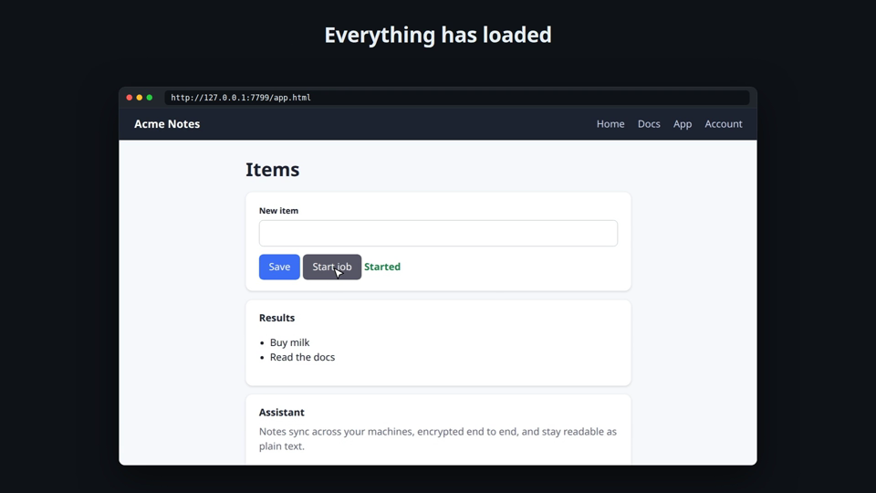

A page that sometimes loads broken can be reloaded until it is ready, and `waitQuiet` works on the whole page too:

```yaml
steps:
  - browser.waitFor: { selector: "#app-ready", reload: 3, each: 20000 }   # reload up to 3 times, 20 s apart
  - browser.waitQuiet: 2500                                               # the whole page's text
```

### Pointing at things

Highlight a passage and scroll to it:

<!-- scene: pointing -->
```yaml
site: http://127.0.0.1:7799/docs.html
steps:
  - browser.scrollTo: "#install"                           # smooth-scroll, upper part of the view
  - browser.highlight: { text: "npm install acme-notes", selector: "#install" }
  - caption: Highlight a passage
  - wait: 2000
```

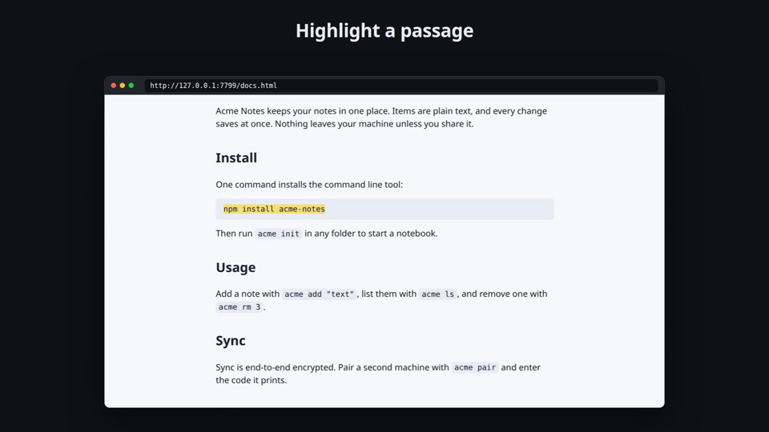

More ways to point at things and pick elements:

```yaml
site: https://example.com/docs
steps:
  - browser.scrollTo: "#install"                           # smooth-scroll, upper part of the view
  - browser.highlight: { text: "npm install democast", selector: "#install" }
  - wait: 2500
  - browser.unhighlight:
  - browser.click: "::-p-text(Getting started)"            # by visible text
  - browser.click: "::-p-aria(Search)"                     # by accessible name
  - browser.click: "::-p-xpath(//button[@type='submit'])"  # by XPath
  - cursor.hide:                                           # fade out the pointer
```

Selectors are CSS plus Puppeteer's `::-p-text()`, `::-p-aria()` and
`::-p-xpath()`. Stable hooks such as `data-demo="..."` attributes survive
markup changes best.

### Navigating

```yaml
site: https://example.com/
steps:
  - browser.open: https://example.com/pricing
  - browser.open: { url: https://example.com/docs, label: "example.com/docs" }  # label: the URL bar text
  - browser.eval: "document.body.style.zoom = 1.1"
```

### Mock a state before filming: eval

```yaml
site: https://example.com/
steps:
  - browser.eval: "document.querySelector('#banner')?.remove()"
  - caption: The page, without the cookie banner
```

---

## 3. Terminal-only scenes

No `site` and no `browser.*` steps: the terminal gets the whole stage.

### Run a command

<!-- scene: terminal-run -->
```yaml
terminal: { title: "~/project — bash", fontSize: 24, cps: 30 }
steps:
  - caption: Install and run
  - term.run: "echo Hello from the terminal"
  - term.run: "printf 'one\\ntwo\\nthree\\n'"
  # show is what is typed, cmd is what runs
  - term.run:
      show: "mytool --demo"
      cmd: "echo mytool is running in demo mode"
  - wait: 800
```

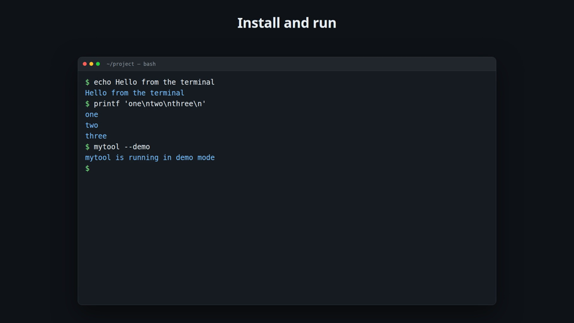

```yaml
terminal: { title: "~/project — bash", fontSize: 24, cps: 30 }
steps:
  - caption: Install and run
  - term.run: "node --version"
  - term.run: "ls -la"
  - term.clear:
  - term.print: { text: "Done.", style: out }      # style: out | err | prompt
  - term.type: "echo this is typed but not run"
```

The command is typed on screen, run with `sh -c`, its output is shown, and
the step waits for it to exit.

### What is typed vs what runs

`show` is what appears on screen, `cmd` is what really runs:

```yaml
steps:
  - term.run:
      show: "mytool --demo"
      cmd: "/opt/build/bin/mytool --demo --config /tmp/demo.toml"
  # show: false types nothing: the output just appears
  - term.run: { cmd: "date", show: false }
```

`cmd` can also be an argv list, which skips shell quoting:

```yaml
steps:
  - term.run: { cmd: [echo, "a  b", "$HOME is not expanded"] }
```

### Control the output

```yaml
steps:
  - term.run: { cmd: "ls /nonexistent", print: stderr, allowFail: true }   # allowFail: non-zero exit is fine
  - term.run: { cmd: "make build", print: none }                           # run it, show nothing
  - term.run: { cmd: "cat", stdin: "text sent on stdin\n", print: stdout }
  - term.run: { cmd: "echo $MODE", env: { MODE: demo } }
  - term.run: { cmd: "sleep 30", timeout: 5000, allowFail: true }         # this step gives up after 5 s
```

`print` is `both` (default), `stdout`, `stderr` or `none`.

### Background commands

A server in the background, a client in the foreground:

<!-- scene: terminal-background -->
```yaml
steps:
  - caption: A server in the background
  - term.run:
      cmd: "python3 -u -m http.server 8099"
      background: true
      id: server
  - term.waitFor: { id: server, regex: "Serving HTTP" }
  - term.run: "curl -s localhost:8099 | head -4"
  - wait: 800
  - term.kill: server
```

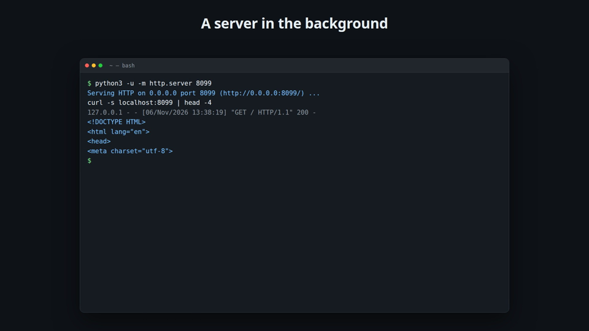

`term.wait: id` waits for a background command to *exit*; `term.waitFor`
waits for it to *print* something. Background commands still running at
the end are killed.

### Capture output into a variable

<!-- scene: terminal-capture -->
```yaml
steps:
  - term.run:
      cmd: "echo 'token: abc123'"
      capture: { var: token, regex: 'token: (\S+)', from: stdout }
  - term.run: "echo the token was {{token}}"
  - wait: 800
```

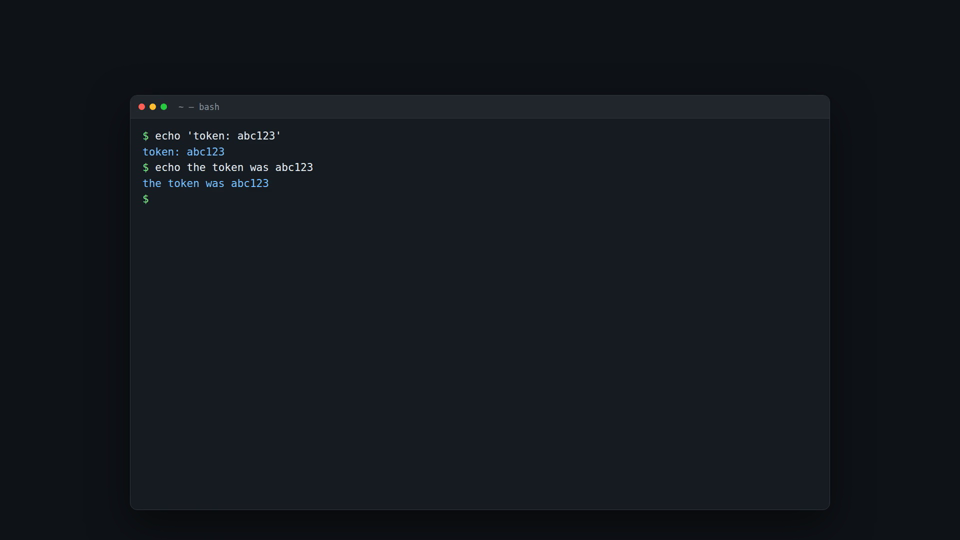

The first match (group 1 if the regex has one) is saved. `from` is `stdout`,
`stderr`, or omitted for either.

---

## 4. Browser and terminal together

With both, the 16x9 stage shows them side by side. Values flow between them
with `{{var}}`: the pattern for capturing a value and reusing it.

### Browser value into a CLI

<!-- scene: browser-to-cli -->
```yaml
site: http://127.0.0.1:7799/listener.html
steps:
  - caption: A value from the browser, used in the terminal
  - browser.click: "#create-listener"
  - browser.capture: { var: addr, selector: "#listen-addr" }
  # {{addr}} in `show` is pasted instantly instead of typed
  - term.run: { show: "send {{addr}}", cmd: "echo sending to {{addr}}" }
  - browser.fill: { selector: "#send-addr", text: "{{addr}}" }
  - browser.click: "#send"
  - wait: 800
```

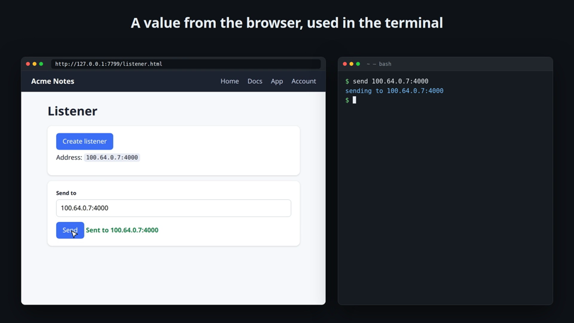

### CLI value into the browser

```yaml
site: https://example.com/app
steps:
  - term.run:
      cmd: "echo 'address: 100.64.0.1:4000'"
      capture: { var: cliAddr, regex: 'address: (\S+)' }
  - browser.fill: { selector: "#send-addr", text: "{{cliAddr}}" }
  - browser.click: "#send"
```

### Capture variants

```yaml
site: https://example.com/app
steps:
  # wait for a non-empty element text
  - browser.capture: { var: title, selector: "h1" }
  # run JavaScript and capture what it returns (waits until non-empty)
  - browser.capture: { var: count, js: "document.querySelectorAll('li').length" }
  # keep group 1 of a regex
  - browser.capture: { var: version, selector: "#footer", regex: 'v(\d+\.\d+)' }
  - caption: "Version {{version}}, {{count}} items"
```

### A long-running command while the browser acts

```yaml
site: https://example.com/app
steps:
  - term.run: { cmd: "sleep 4 && echo done", background: true, id: job }
  - browser.click: "#start"
  - browser.waitFor: { text: "Started" }
  - term.wait: job          # now wait for the command to finish
```

### Which panel is shown

In the side-by-side formats (16x9, 1x1, 4x5) `view:` shows one panel alone
and then both again:

<!-- scene: view -->
```yaml
site: http://127.0.0.1:7799/app.html
steps:
  - view: browser
  - caption: First, the browser on its own
  - browser.click: "#accept"
  - view: term
  - caption: Now the terminal alone
  - term.run: "echo now only the terminal"
  - wait: 800
```

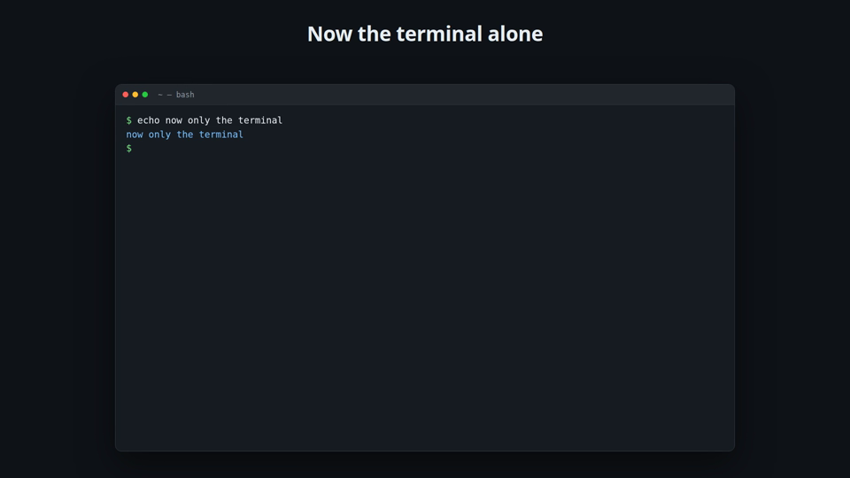

As the first step, the video opens on that view. In 9x16, `focus: browser` or
`focus: term` switches panels by hand (with `autoFocus: false`):

```yaml
site: https://example.com/app
autoFocus: false
formats: [9x16]
steps:
  - focus: browser
  - browser.click: "#go"
  - focus: term
  - term.run: "echo hi"
```

---

## 5. Two terminals

Any `term.*` step takes `pane: 2`. The scene shows two terminals instead
of a browser, side by side when the area is wider than tall and stacked
otherwise.

<!-- scene: two-terminals -->
```yaml
terminal:  { title: "server — bash" }
terminal2: { title: "client — bash" }
steps:
  - caption: A server and a client
  - term.run: { cmd: "python3 -u -m http.server 8098", background: true, id: srv }
  - term.waitFor: { id: srv, regex: "Serving HTTP" }
  - term.run: { pane: 2, cmd: "curl -s -o /dev/null -w '%{http_code}\\n' localhost:8098" }
  - wait: 800
  - term.kill: srv
```

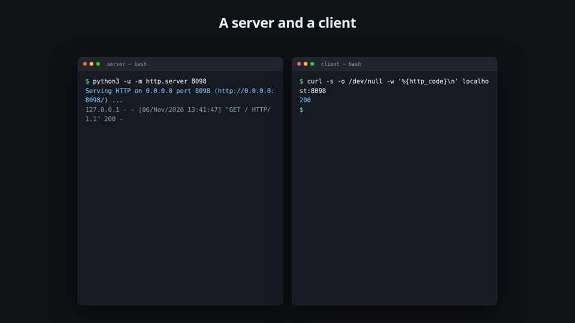

At most two panes, and a scene with two can't also show the browser.

---

## 6. Stage: cards, captions, views

### Title and end cards

<!-- scene: cards-title -->
```yaml
site: http://127.0.0.1:7799/
steps:
  # A card as the first step is shown before recording begins
  - card:
      image: ../../examples/tailground.png
      title: Meet Acme Notes
      sub: "Notes that stay on your machine"
  - wait: 2500
```

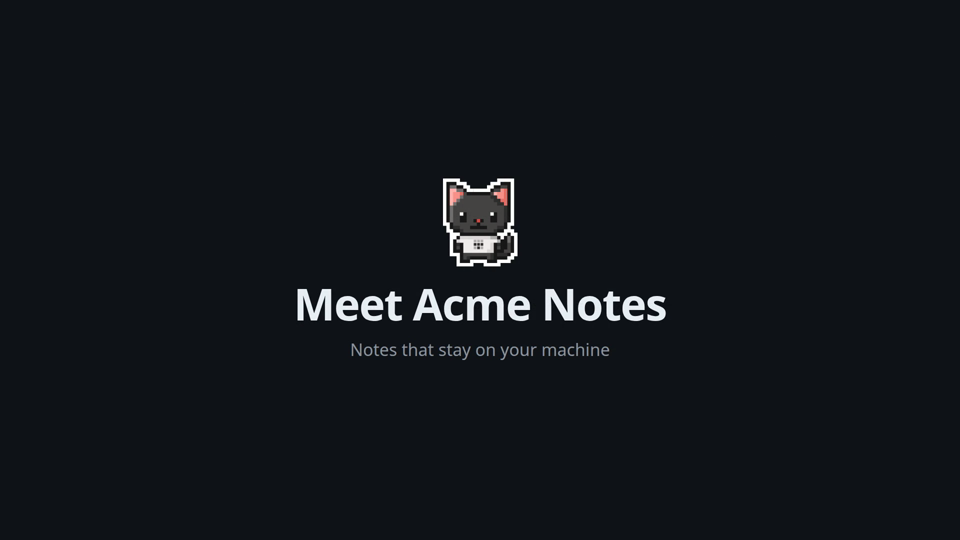

<!-- scene: cards-end -->
```yaml
site: http://127.0.0.1:7799/
steps:
  - caption: Thanks for watching
  - wait: 800
  - card:
      title: Try it now
      link: acme.test
      pills: [Free, No account, Open source]
      footer: github.com/acme/notes
  - wait: 2500
```

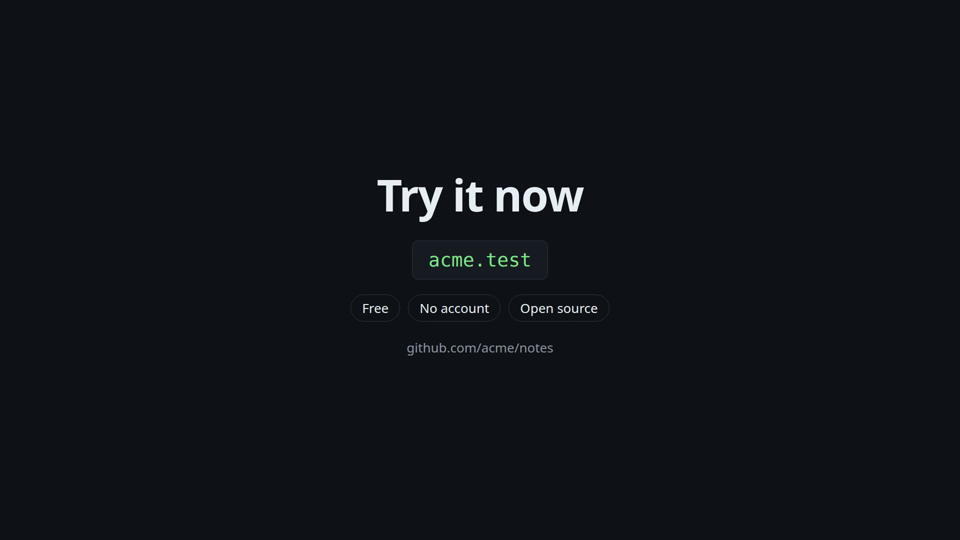

A card can also be shown and faded out mid-scene, with narration over it:

```yaml
steps:
  - card: { title: Meet the product, sub: "A one-line description" }
  - say: { text: "Welcome.", wait: false }
  - browser.waitFor: { selector: "body" }
  - hideCard: { minShown: 3000 }   # fade out, but not before 3 s
```

### Captions

```yaml
site: https://example.com/
steps:
  - caption: A plain caption
  - caption: { text: With a subtitle, sub: "and a second, smaller line" }
  - wait: 1500
  - caption: ""
```

---

## 7. Narration

`say` steps add a voice-over. Every line is synthesized before recording
starts, so the runner knows each clip's length.

```yaml
site: https://example.com/
voice:
  engine: kokoro
  voice: am_michael
  speed: 1.05
  pronounce: { example: ex-ample }    # respellings for the voice only; subtitles keep the original
  volume: 1
steps:
  # waits until the line ends before the next step
  - say: "Open the page and look around."
  # keeps going while it plays: speech runs over the clicks
  - say: { text: "Then click the link.", wait: false }
  - browser.click: "a"
  # per-line voice override
  - say: { text: "Bonjour !", voice: { voice: ff_siwis, lang: fr-fr } }
```

Lines can't use `{{variables}}`, since they are synthesized before anything
runs. A line never starts before the previous one has finished.

### Engines

```yaml
# Kokoro: light, CPU-only, about 330 MB of model (the default)
voice: { engine: kokoro, voice: af_heart, speed: 1.0, lang: en-us, model: fp32 }   # model: int8 is 90 MB
```

```yaml
# VibeVoice: more expressive, heavier (PyTorch, about 2 GB, GPU recommended)
voice: { engine: vibevoice, voice: Carter, device: cuda, cfg: 1.5, steps: 5 }
```

```yaml
# Any program that reads text on stdin and writes a WAV to {out}, e.g. Piper
voice: { engine: command, command: "piper -m en_US-lessac-medium.onnx -f {out}" }
```

Try voices without recording, or skip narration for a quick take:

```
node src/cli.js --voice kokoro:af_heart --voice-only scene.yaml   # synthesize, print clip files, stop
node src/cli.js --voice vibevoice:Emma scene.yaml                 # override the scene's voice
node src/cli.js --no-voice scene.yaml                             # silent take; say steps do nothing
```

Clips are cached in `out/.cache/tts`, so re-recording does not synthesize
again. If you share a video with VibeVoice narration, say it is AI-generated.

---

## 8. Formats, resolution and frame rate

<!-- scene: formats -->
```yaml
site: http://127.0.0.1:7799/app.html
formats: [16x9, 9x16, 4x5, 1x1]
steps:
  - caption: Four formats from one scene
  - browser.click: "#accept"
  - wait: 1500
```

<table><tr><td align="center" valign="top">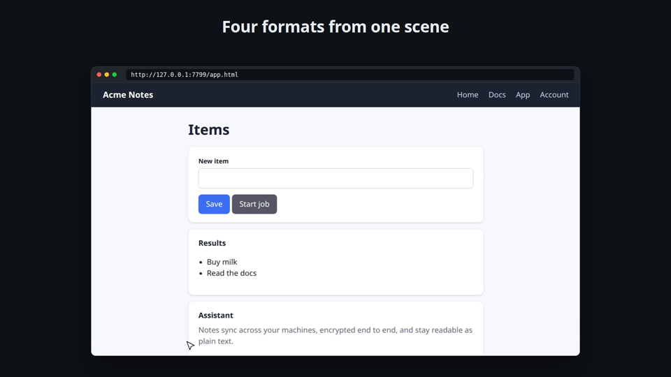<br><code>16x9</code></td><td align="center" valign="top">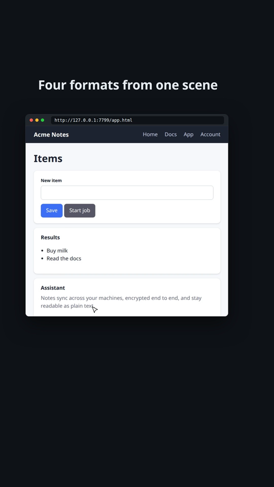<br><code>9x16</code></td><td align="center" valign="top">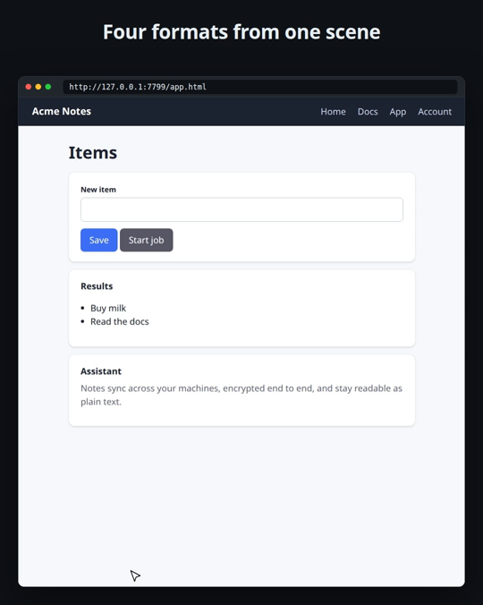<br><code>4x5</code></td><td align="center" valign="top">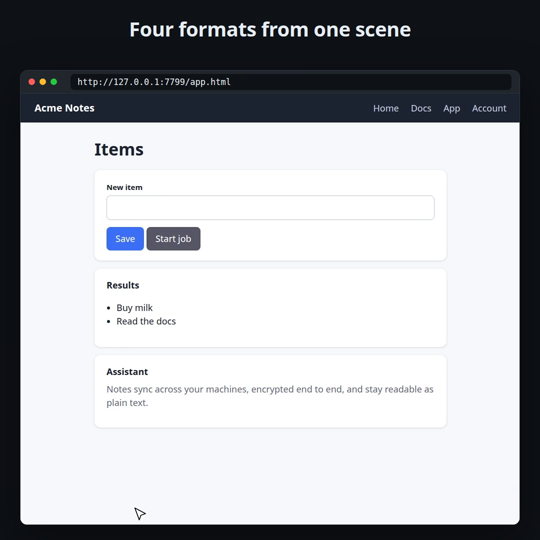<br><code>1x1</code></td></tr></table>

| Format | Size | For |
|---|---|---|
| `16x9` | 1920×1080 | LinkedIn, YouTube, X |
| `1x1` | 1080×1080 | square feed posts |
| `4x5` | 1080×1350 | portrait feed posts |
| `9x16` | 1080×1920 | TikTok, Reels, Shorts |

```
node src/cli.js scene.yaml                  # all formats the scene lists
node src/cli.js -f 9x16,1x1 scene.yaml      # just these
node src/cli.js --4k scene.yaml             # 3840×2160; output named scene-16x9@2x.mp4
node src/cli.js -s 2 --fps 60 scene.yaml    # scale 2 at 60 fps
node src/cli.js -o renders scene.yaml       # output directory
node src/cli.js --guides -f 9x16 scene.yaml # shade the areas TikTok/Reels UI covers
```

### Per-format tuning

```yaml
site: https://example.com/
browser:
  scale: { 16x9: 1.2, 9x16: 1.0, 1x1: 1.0 }   # site zoom per format
terminal:
  fontSize: { 16x9: 21, 9x16: 30 }
formats: [16x9, 9x16]
steps:
  - caption: Sized for each format
```

### 9x16 layouts

9x16 shows one panel at a time (large, readable on a phone) and slides to
whichever panel each step uses. Alternatives:

The default, one panel at a time:

<!-- scene: layout-focus -->
```yaml
site: http://127.0.0.1:7799/listener.html
formats: [9x16]
steps:
  - browser.click: "#create-listener"
  - term.run: "echo one panel at a time"
  - wait: 800
```

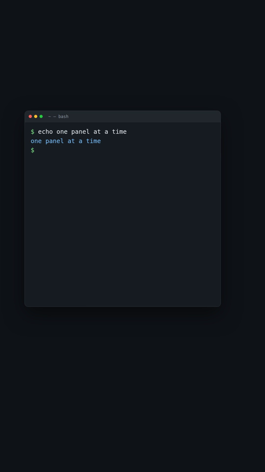

<!-- scene: layout-both -->
```yaml
site: http://127.0.0.1:7799/listener.html
formats: [9x16]
layout: both          # stack the two panels (browser above terminal) instead
steps:
  - caption: Stacked
  - browser.click: "#create-listener"
  - term.run: "echo stacked"
  - wait: 800
```

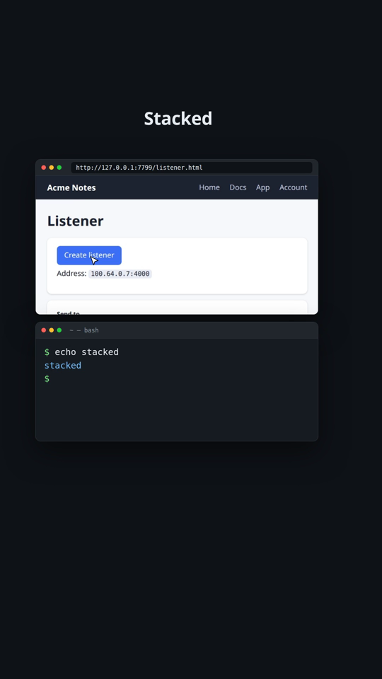

<!-- scene: layout-max -->
```yaml
site: http://127.0.0.1:7799/docs.html
formats: [9x16]
layout: max           # a one-panel scene fills the frame (no room for captions)
steps:
  - browser.scrollTo: "#install"
  - wait: 1000
```

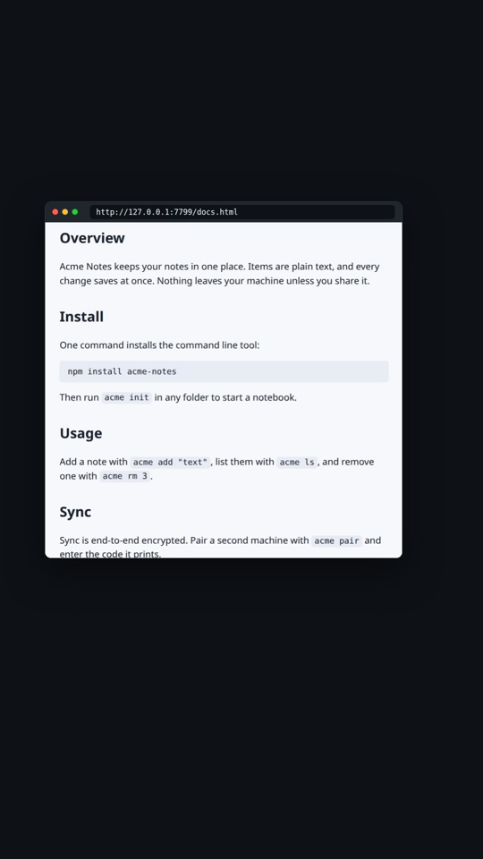

```yaml
site: https://example.com/
formats: [9x16]
autoFocus: false      # switch by hand with focus: steps
steps:
  - focus: browser
```

---

## 9. Sites behind a login

### A saved signed-in profile (best for Google, Microsoft, GitHub, SSO, passkeys)

```yaml
name: dashboard
site: https://app.example.com/dashboard
browser:
  profile: dashboard-demo                    # or `true` to use the scene's name
  loginUrl: https://app.example.com/login    # where `democast login` opens (default: site); a list opens a tab each
steps:
  - caption: Already signed in
  - browser.waitFor: { text: "Dashboard" }
```

Sign in once, in a plain Chrome window with no automation attached:

```
node src/cli.js login dashboard.yaml          # sign in, close the window
node src/cli.js login --profile other scene.yaml   # a different profile name
```

The profile is saved in `~/.config/democast/profiles/<name>` (readable only
by you). Each take starts from a fresh copy of it, so recording never
changes the saved profile. When the session expires, recording fails at the
first step that needs it: run `login` again. Treat a saved profile like a
password.

### Several login tabs

```yaml
site: https://app.example.com/
browser:
  profile: multi
  loginUrl: [https://accounts.example.com/login, https://app.example.com/]
steps:
  - caption: Signed in
```

### Google: use the saved profile itself

Google rotates session cookies as they are used, so a take that starts from
a copy would throw the new ones away. For Google sessions:

```yaml
site: https://myaccount.google.com/
browser:
  profile: some-demo
  saveSession: true     # run on the saved profile, not a copy; one take at a time
steps:
  - caption: A Google account
```

Every scene sharing the profile needs `saveSession: true`.

### HTTP basic auth and headers

```yaml
site: https://staging.example.com/
browser:
  auth: { username: demo, password: "{{env.DEMO_PASSWORD}}" }
  headers: { Authorization: "Bearer {{env.DEMO_TOKEN}}" }     # sent with every request
steps:
  - caption: Staging
```

### A scripted form login (plain email and password only)

```yaml
site: https://app.example.com/login
setup:
  - browser.fill: { selector: "#email", text: "{{env.DEMO_EMAIL}}" }
  - browser.fill: { selector: "#password", text: "{{env.DEMO_PASSWORD}}" }
  - browser.click: "button[type=submit]"
  - browser.waitFor: { text: "Dashboard" }
steps:
  - caption: Signed in by setup, off camera
```

This will not get past 2FA, captchas or single sign-on; use a saved profile
for those.

---

## 10. Setup and teardown

`setup:` runs before recording starts and is not in the video.
`teardown:` runs after each take, including a failed one, so a scene that
creates something can delete it before the next format or retry. A failing
teardown step is a warning, and the rest still run.

<!-- scene: setup-teardown -->
```yaml
site: http://127.0.0.1:7799/app.html
setup:                                  # before recording; not in the video
  - browser.waitFor: { selector: "#results" }
  - browser.click: "#accept"
steps:
  - caption: Create an item
  - browser.type: { selector: "#name", text: "Write the docs" }
  - browser.click: "#save"
  - browser.waitFor: { text: "Write the docs" }
  - wait: 1000
teardown:                               # after each take, even a failed one
  - browser.eval: "localStorage.clear()"
```

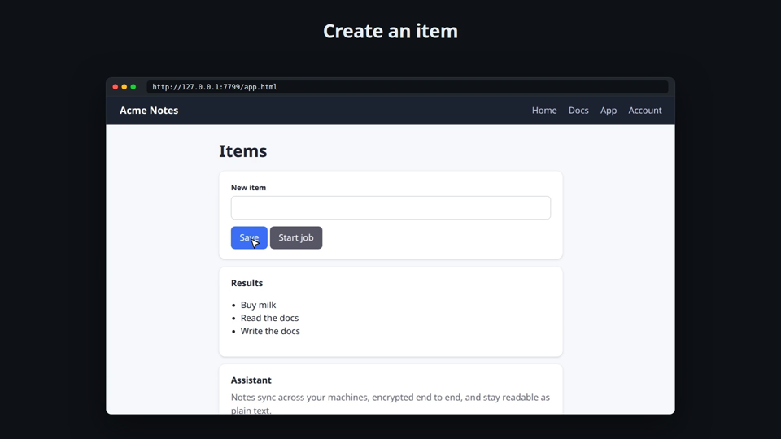

Setup and teardown can run commands too, for a scene that changes a real system and must put it back:

```yaml
setup:
  - term.run: { cmd: "curl -sS -X DELETE $API/demo-items", allowFail: true }
teardown:
  - term.run: { cmd: "curl -sS -X DELETE $API/demo-items", allowFail: true }
```

Setup is also the place to prepare the page, such as waiting for a page's engine to load before the
camera starts ([examples/tailground.yaml](examples/tailground.yaml)).

---

## 11. Privacy: redact and blur

A signed-in session shows real names, emails, device names and IPs. Use a
demo account where you can, and hide the rest.

### Redact text, wherever it appears

<!-- scene: redact -->
```yaml
site: http://127.0.0.1:7799/account.html
redact:
  - email                                                    # a preset
  - { text: "Alex Morgan", with: You }                       # a literal string
  - { regex: 'sk_live_[A-Za-z0-9]+', with: sk_live_XXXX }   # a pattern
steps:
  - caption: Names, emails and keys are hidden
  - wait: 2000
```

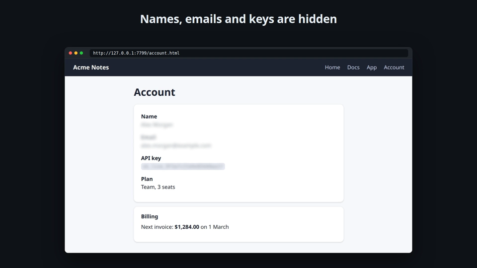

In the terminal and URL bar, matches are replaced with `with` (without it,
the match is blocked out). In the site, matches are blurred from the first
paint and as the page changes, including streaming text. It is text-based:
it can't see text in images or form fields.

### Blur whole elements

<!-- scene: blur -->
```yaml
site: http://127.0.0.1:7799/account.html
browser:
  blur: [".user-email"]                 # from the first paint of every page
steps:
  - browser.blur: ".invoice-total"      # on demand
  - caption: Blurred by selector
  - wait: 1500
```

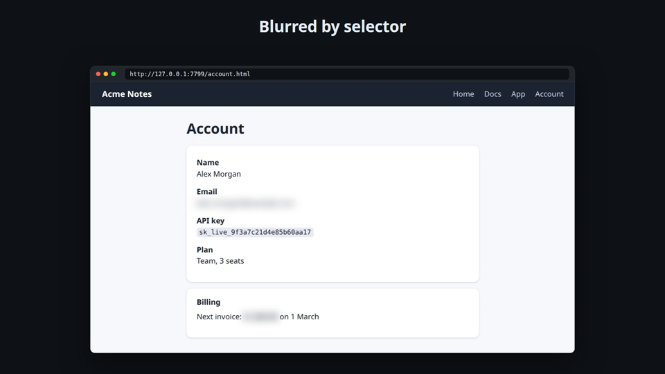

### Record without hiding anything

For takes you will not publish:

```
node src/cli.js --no-redact scene.yaml
```

---

## 12. Popups and OAuth

`browser.popup` clicks inside a window the site opened (an OAuth sign-in,
say), off camera: popups are not in the video.

Click through an OAuth sign-in:

<!-- scene: popup -->
```yaml
site: http://127.0.0.1:7799/connect.html
steps:
  - caption: Connect your calendar
  # click the trigger on the site; it opens the popup; click "Allow" in it, off camera
  - browser.popup: { trigger: "#sign-in", click: "#allow" }
  - browser.waitFor: { text: "Calendar connected" }
  - wait: 1000
```

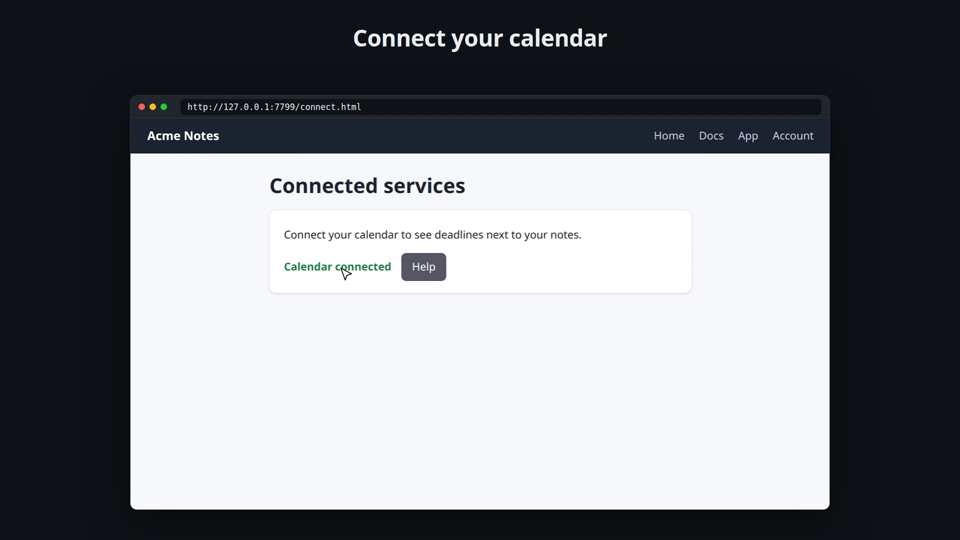

More ways to use it:

```yaml
site: https://app.example.com/login
steps:
  # click the trigger on the site; it opens the popup; click "Allow" in it
  - browser.popup: { trigger: "#sign-in-with-provider", click: "#allow" }

  # only a popup whose address contains this
  - browser.popup: { trigger: "#connect", click: "#approve", url: "oauth.example.com" }

  # several dialogs in a row
  - browser.popup: { trigger: ["#connect", "#connect-again"], click: "#continue" }

  # unless: if a popup already shows #welcome (already signed in), skip the step
  - browser.popup: { trigger: "#sign-in", click: "#allow", unless: "#welcome" }

  # short form: just the selector to click in an already-open popup
  - browser.popup: "#ok"
```

The trigger is clicked, and clicked again every few seconds while no popup
appears. If nothing matches in time, the error lists what the popups did
show.

### Film a popup

To put a popup window *in* the browser panel so the steps after it are
filmed and act on it:

<!-- scene: show-popup -->
```yaml
site: http://127.0.0.1:7799/connect.html
steps:
  - browser.click: "#open-help"
  - browser.showPopup: /help            # url picks the popup; default: the newest
  - browser.click: "#next"              # acts in the popup, on camera
  - caption: The popup, filmed in the browser panel
  - wait: 1000
```

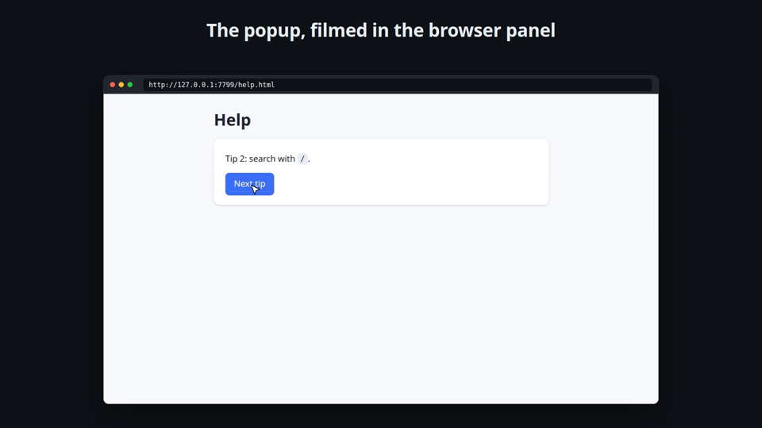

---

## 13. Variables and environment

`{{var}}` is a captured value; `{{env.NAME}}` is an environment variable.
Both work in strings in steps.

```yaml
env: { REGION: eu }                      # added to the environment of terminal commands
site: https://example.com/
steps:
  - browser.fill: { selector: "#key", text: "{{env.DEMO_KEY}}" }   # {{env.NAME}} reads your shell's environment
  - browser.capture: { var: id, selector: "#item-id" }
  - term.run: { show: "get {{id}}", cmd: "echo fetching {{id}} in $REGION" }   # $REGION comes from the scene's env:
```

`{{env.NAME}}` reads the environment democast runs in, so set it when you
run. The scene's `env:` only adds variables for terminal commands (read as
`$REGION` by the shell, not `{{env.REGION}}`):

```
DEMO_KEY=abc node src/cli.js scene.yaml
```

A variable must be captured before it is used, and `democast check` warns
about env variables that are not set and `{{var}}`s used too early.

---

## 14. Music

```yaml
site: https://example.com/
music: { file: music.mp3, volume: 0.5 }     # path relative to the scene; looped, faded, ducked under narration
voice: { engine: kokoro, voice: am_michael }
steps:
  - say: "Music plays under the narration."
  - wait: 2000
```

The mix is normalized to -16 LUFS. Voice and music volume can also be
changed in the editor.

---

## 15. Smooth takes and sources

### Smooth: every frame, at any scale

A live capture can only deliver as many frames as the machine can draw, so
4K cursor moves, typing and scrolling can stutter. `--smooth` records live
as usual but logs everything, then replays the log frame by frame:

```
node src/cli.js --smooth --4k --fps 60 scene.yaml
```

Rendering takes about two to three times the take's length after the run.

### Sources: each window alone, for your own edit

```
node src/cli.js --sources scene.yaml
```

Implies `--smooth`, and also writes `scene-16x9-browser.mp4`,
`scene-16x9-terminal.mp4` (and `-terminal2.mp4` with two panes), each
terminal as a self-contained `-terminal.html` that you can copy from and
play, and the replay log `scene-16x9.log/`.

```
node src/cli.js --sources -j 4 scene.yaml        # render sources 4 at a time (default 3)
```

### Sources later, in a batch

To keep a run of takes short, keep the log but render no sources, then
render them all afterwards:

```
node src/cli.js --sources-later scene.yaml
node src/cli.js sources out/                    # every *.log in out/ whose sources are missing or older
node src/cli.js sources out/scene-16x9.log -j 6 # one take, six at a time
node src/cli.js sources --force out/            # render again
```

### The terminal as HTML

`-terminal.html` plays on the take's clock, with controls (play/pause,
scrubber, speed). Open it at a time, or autoplay:

```
scene-16x9-terminal.html#t=12.5
scene-16x9-terminal.html?autoplay
```

From a script: `democastTerminal.seek(s)`, `.play()`, `.pause()`,
`.duration`. Restyle it with the `--dc-*` CSS variables at the top of the
file.

---

## 16. The timeline editor

Trim and tighten a recorded take without recording again.

```
node src/cli.js edit scene.yaml                   # open the link it prints (http://localhost:7717/?token=…)
node src/cli.js edit --open --port 8000 scene.yaml
node src/cli.js render scene.yaml                 # re-render every take with the current edits
node src/cli.js render -f 9x16 scene.yaml         # just one format
```

In the editor:

| Do | How |
|---|---|
| **Cut** a part | drag on the Edits lane, pick *cut* |
| **Speed up** a slow wait | pick *speed* (1.5–8×) |
| **Overlay text** | pick *text*: a one-line caption at the top, center or bottom, inside the safe area |
| **Trim** the start and end | drag the orange handles, or press I and O at the playhead |
| Move or resize a region | drag it or its edges; edges snap to steps and narration, Alt stops snapping |
| Preview as rendered | turn on *Preview edits* |
| Render | *Render* (this format) or *Render all* |

Edits are saved next to the scene as `scene.edits.yaml`. Commit it with the
scene. They are anchored to steps, as "this many seconds into step N", so
one set of edits applies to every format and survives re-recording. If you
add or remove steps, existing edits can land on the wrong ones: the editor
flags takes recorded before such a change.

---

## 17. Remix: new videos from recorded takes

A scene with `remix: true` records nothing. It cuts clips out of takes that
kept their log (`--sources` or `--sources-later`), and puts them between
cards, captions and narration, in any format. A 16x9 pass becomes a 9x16
short without touching the system it recorded.

```
node src/cli.js --sources scene.yaml      # first, a take that keeps scene-16x9.log/
node src/cli.js short.yaml                # then the remix
```

```yaml
remix: true
formats: [9x16]
voice: { engine: kokoro, voice: am_michael }
takes:                                    # short names for takes (paths from this file's folder)
  main: ../out/scene-16x9
steps:
  - card: { title: You got the invite. }
  - hideCard: { minShown: 3000 }
  - caption: { text: "Their side names one tag" }
  - say: { text: "The other tailnet lists the one tag you may refer to.", wait: false }
  # the browser window, 1.5 s to 9.5 s, zoomed to a box of the page
  - clip: { take: main, window: browser, from: 1.5, to: 9.5, zoom: { x: 0.25, y: 0.24, w: 0.42 } }
  # the terminal window, 19.4 s to 30 s, at 1.5x
  - clip: { take: main, window: term, from: 19.4, to: 30, speed: 1.5 }
  - clip: { take: main, window: term2, from: 0, to: 4, title: "client — bash" }
  # change zoom at once instead of panning, and hide the take's pointer
  - clip: { take: main, from: 12, to: 14, zoom: { x: 0, y: 0.5, w: 1 }, pan: false, pointer: false }
```

| `clip` setting | |
|---|---|
| `take` | a name from `takes`, or a path: `<take>.log/`, its base name or its MP4 |
| `window` | `browser` (default), `term` or `term2` |
| `from`, `to` | seconds into the take |
| `speed` | faster (2) or slower (0.5) |
| `zoom` | `{x, y, w}`: the box of the page to show, as fractions; consecutive boxes pan and zoom between them |
| `pan` | `false`: switch to this zoom box at once |
| `pointer` | `false`: hide the take's pointer |
| `title` | terminal: the window's title |

The other steps in a remix are `card`, `hideCard`, `caption`, `say`, `wait`
and `cursor.hide`. A remix renders like a smooth take, with narration,
subtitles, a contact sheet and edits, and `democast render` re-renders it.

---

## 18. Checking a scene

```
node src/cli.js check scene.yaml
```

Without running anything or starting Chrome, `check` validates the scene
against the schema (a typo stops with the place to fix, such as
`steps[4].term.run: unknown setting "comand"`), and reports unset
`{{env.NAME}}` variables, `{{var}}`s used before they are captured, missing
card images and music, a missing browser profile, and layouts a format
can't do. It ends with a summary:

```
scene tailground: 15 step(s)
panels: browser, term
formats: 16x9, 9x16, 4x5, 1x1
narration: 5 line(s), kokoro (am_michael), 53 words
takes: 3 in out
edits: 0 region(s)
ok
```

---

## 19. Flaky networks: retries and waiting

```
node src/cli.js -r 2 scene.yaml        # re-record a failed take up to 2 more times
node src/cli.js --headed scene.yaml    # show the browser while recording, to debug
node src/cli.js -q scene.yaml          # don't print each step
```

Per-step timeouts, beside the action or inside it:

```yaml
site: https://example.com/
timeout: 30000                 # default for every step
steps:
  - browser.waitFor: { selector: "#slow-widget" }
    timeout: 90000             # this step only
  - term.run: { cmd: "make test", timeout: 600000 }
  - browser.click: "#go"
```

When a step fails, `out/scene-16x9-error.png` shows the page at that moment.

---

## 20. Make targets

`make help` lists them all. The common ones:

```
make check                                    # are node, ffmpeg, Chrome, uv installed?
make check-scene SCENE=scene.yaml             # is the scene ready to record? (no Chrome)
make login SCENE=scene.yaml                   # sign in, saving the session
make record SCENE=scene.yaml FORMAT=9x16,4x5 VOICE=vibevoice:Emma RETRIES=2
make 9x16                                     # one format; also 16x9, 4x5, 1x1
make 4k                                       # 4K
make guides                                   # safe-zone check
make silent                                   # no narration
make kokoro VOICE=af_heart                    # audition narration without recording
make edit OPEN=1                              # timeline editor
make render                                   # re-render takes with the current edits
make clean                                    # remove output
make typecheck                                # type-check the code
```

Variables: `SCENE`, `FORMAT`, `OUT`, `RETRIES`, `VOICE`, `SCALE`, `CHROME`,
`PORT`, and `NO_VOICE`, `GUIDES`, `HEADED`, `QUIET`, `OPEN` set to 1.
`EXTRA` passes anything else through.

---

## 21. Running in CI

A recording is also an end-to-end smoke test, since every step waits for
real conditions. Re-record on release to keep the video in step with the UI:

```yaml
# .github/workflows/demo-video.yml
on: { release: { types: [published] }, workflow_dispatch: {} }
jobs:
  video:
    runs-on: ubuntu-latest
    steps:
      - uses: actions/checkout@v4
      - uses: actions/setup-node@v4
        with: { node-version: 22 }
      - uses: astral-sh/setup-uv@v6   # for narration
      - run: sudo apt-get update && sudo apt-get install -y ffmpeg fonts-noto-color-emoji
      - run: npm ci && node src/cli.js -r 2 examples/tailground.yaml
        env: { CHROME_PATH: /usr/bin/google-chrome }
      - uses: actions/upload-artifact@v4
        with: { name: demo-video, path: out/ }
```

`--chrome PATH` or `$CHROME_PATH` picks the browser; `democast check` is a
fast pre-flight that needs no browser.

---

## Limits

- Timing follows real time, so network delays show up in the video.
- CSS selectors break when the site's markup changes.
- With `--smooth`, the live stage is not drawn at full resolution and
  `--headed` shows little.
- Linux and macOS only: commands run with `sh -c`.
- Two terminal panes at most, and a scene with two can't also show the browser.
